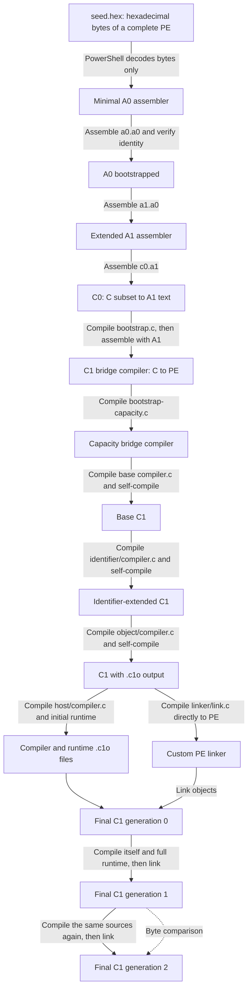

[简体中文](BOOTSTRAP.zh-CN.md) · English

# From a hexadecimal seed to a C compiler

The project starts with hexadecimal machine-code text and progressively builds assemblers, C-subset compilers, a self-compiling C compiler, and an independent PE linker. This page explains the design; executable steps are in [WALKTHROUGH.md](WALKTHROUGH.md).

## Build chain

Arrows mean using an existing tool to build the next stage. All sources are included in the release. Functional tests described below belong to staged or full builds; the default fast build retains the generation chain and identity checks but skips test branches.



Source paths below are relative to `src/bootstrap-c99/`. `stage0`, `stage1`, and `stage2` denote build generations of one tool, not language versions. Files named `c1-stage2.exe` in different directories also belong to different compiler stages.

## 1. A0: bytes and address resolution

`base/decode_seed.ps1` decodes the literal hexadecimal bytes in `base/seed.hex` into `a0-seed.exe`: a complete 3,584-byte Windows x64 PE program.

The decoder only validates and converts bytes. It does not resolve labels, encode instructions, or generate PE structures; those are already in the seed.

A0 supports raw hexadecimal bytes, numeric labels, absolute addresses, and relative offsets. It resolves references and emits binary bytes.

A0's assembly source is `base/a0.a0`. The seed assembles it into generation one, which assembles the same source into generation two. The build requires all three to be byte-identical; regression validation includes 30 functional and error-handling tests.

`seed.hex` is a text representation of complete machine code; `a0.a0` is assembly source requiring label and address resolution.

## 2. A1: extended assembly language

`base/a1.a0` describes A1 in a form A0 can process. A0 first assembles A1; A1 then assembles itself twice, and the three results are compared.

A1 adds named labels, strings, zero padding, and a small set of x64 instruction mnemonics for the next tools. It is not a complete MASM or NASM implementation.

## 3. C0: a C-subset compiler

`base/c0.a1` is a C-subset compiler written in A1 assembly. A1 assembles it into `c0.exe`.

C0 translates supported C source into A1 text, which A1 then turns into an executable:

```text
C source ──C0──> A1 assembly text ──A1──> Windows x64 executable
```

C0 implements only the C subset needed to build the next tool, not complete C89/C99.

A validation branch uses C0 and A1 to build `base/c1/lexer.c` and test its tokenization. A later C1 rebuilds the same source for comparison.

## 4. Bridge compilers

Two bridge stages progressively satisfy the language and capacity requirements of base C1:

| Source | Tool used | Result and purpose |
| --- | --- | --- |
| `base/c1/bootstrap.c` | C0, then A1 | `c1-bridge.exe`: a bridge written in restricted C that emits PE directly |
| `base/c1/bootstrap-capacity.c` | Bridge compiler | `c1-capacity.exe`: larger input/code buffers and other capacities to accommodate base C1 |
| `base/c1/compiler.c` | Capacity bridge compiler | Base `c1-stage0.exe`: capable of compiling base C1 itself |

From the bridge compiler onward, C compilers generate machine instructions and PE files directly, without passing each result through A1.

Base C1 generation zero compiles itself to produce generation one, which produces generation two. The build compares the latter pair and runs functional tests on each.

## 5. Identifier and object-file support

Base C1 is extended in two further stages:

| Source | Starting tool | Responsibility |
| --- | --- | --- |
| `identifier/compiler.c` | Base C1 generation two | Extends identifier handling for later sources |
| `object/compiler.c` | Identifier-extended C1 generation two | Adds custom `.c1o` output for separate compilation and linking |

Each stage builds three generations and compares the latter two. The object compiler retains direct PE output to build the linker.

`.c1o` is the project's object format for its custom linker, not a Windows SDK COFF object or import-library format.

## 6. PE linker

The two generations of object-output C1 compile `linker/link.c` directly into `link-stage1.exe` and `link-stage2.exe`; the results must be byte-identical.

The linker processes `.c1o` symbols and relocations and generates PE executables using the specified entry point and DLL imports.

Linker-generation identity compares outputs of two C compiler generations. The linker itself does not compile C source.

## 7. Final C1 and runtime

The final compiler, `host/compiler.c`, and its runtime are compiled separately and combined by the custom linker:

```text
host/compiler.c ──existing C1──> compilerN.c1o ─┐
                                             ├─custom linker─> host/c1-stageN.exe
Runtime C source ──existing C1──> runtimeN.c1o ─┘
```

Generation zero uses the preceding object compiler and `runtime/bootstrap-runtime.c`.

Generation zero compiles its own source and the full `runtime/runtime.c`, which are linked into generation one. Generation one repeats this process to produce generation two.

The build compares three pairs:

- Compiler objects: `compiler1.c1o` and `compiler2.c1o`.
- Runtime objects: `runtime1.c1o` and `runtime2.c1o`.
- Final executables: `c1-stage1.exe` and `c1-stage2.exe`.

After a one-command build, the final tools are:

| Tool | Path relative to the release root |
| --- | --- |
| Final C compiler | `src/bootstrap-c99/build-from-seed/host/c1-stage2.exe` |
| Custom PE linker | `src/bootstrap-c99/build-from-seed/link-stage2.exe` |

Applications use the same object-plus-runtime linking process. Driver configuration is documented in [USAGE.md](USAGE.md).

## Validation scope

Identical self-compiled artifacts demonstrate build stability, not behavioral correctness. The project separately tests functionality, rejection of invalid input, the runtime, linking, and Windows DLL imports.

Staged builds do not replace full acceptance testing. See [README.md](README.md#build-modes) for each mode's scope and [WALKTHROUGH.md](WALKTHROUGH.md) for validation commands. Passing tests does not prove complete C99 conformance; see [Implementation notes](src/C89-IMPLEMENTATION.md) and [Limits](src/C89-LIMITS.md).

## Roles of scripts, Windows, and custom tools

PowerShell performs initial byte decoding, then process orchestration, file handling, source-text preparation, testing, and verification. Binaries after the seed are generated by custom tools. Windows supplies program loading and system DLL services. No external C compiler, assembler, linker, or Windows SDK is required.

Implementation entry points, relative to `src/bootstrap-c99/`:

1. `base/a0.a0`, `base/a1.a0`, `base/c0.a1`: the first three tools.
2. `base/build-c1.ps1`: dependencies for the two bridges and base C1.
3. `build-toolchain.ps1`: identifier, object, linker, and final C1 stages.
4. `compile-program.ps1`: using the final toolchain for applications.

Build modes and environment requirements are in [README.md](README.md).
