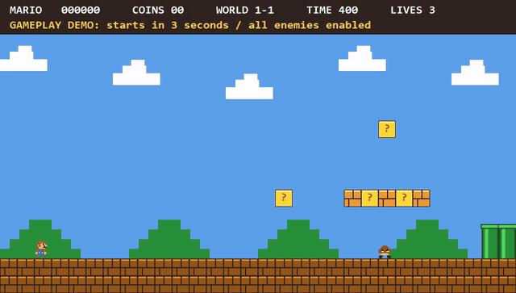
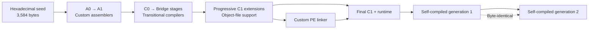

[简体中文](README.zh-CN.md) · English

<div align="center">

# BitKindle

### A Windows x64 C compiler bootstrapped from a 3,584-byte machine-code seed

[](#quick-start)
[](BOOTSTRAP.md)
[](BOOTSTRAP.md)
[](LICENSE)

[Quick start](#quick-start) · [Bootstrap design](BOOTSTRAP.md) · [Walkthrough](WALKTHROUGH.md) · [Usage](USAGE.md) · [Examples](#examples)

</div>
<p align="center">
  
</p>

<p align="center">
  <strong>Mario example built with the BitKindle toolchain</strong><br/>
  Actual gameplay recording · Built-in automated player completes the level · Preview at 2× speed<br/>
  <a href="src/examples/mario/README.md">Build and run instructions</a>
</p>

---

## Overview

BitKindle includes the complete sources for the A0/A1 assemblers, C0 transitional compiler, self-hosted **C1** compiler written in C, runtime library, and PE linker.

**Building requires no MSVC, GCC, Clang, Windows SDK, or external linker, and downloads no dependencies.** PowerShell 5.1 decodes the seed and orchestrates the build. After decoding, every machine-code binary, object file, and EXE is generated by previously built custom tools.

## Bootstrap pipeline



See [BOOTSTRAP.md](BOOTSTRAP.md) for stage dependencies and [WALKTHROUGH.md](WALKTHROUGH.md) for building individual stages with `build-stage.ps1`.

## Quick start

Requires **Windows x64 and Windows PowerShell 5.1** (`powershell.exe`); the verified environment is Windows 10 x64. Place the complete source tree in a writable local directory with a short path, preserving the name and hierarchy of `src/`. Reserve **5 GiB** for the full test run.

Run from the release root:

```powershell
powershell.exe -NoProfile -NonInteractive -ExecutionPolicy Bypass -File .\build-all.ps1
```

The default builds the compiler, linker, and C89/C99 runtimes, **without running regression tests**. After a successful build, compile and run hello:

```powershell
$snapshot = './src/bootstrap-c99'
& "$snapshot/compile-program.ps1" -Source "$snapshot/examples/hello.c" `
    -Output './work/my-hello.exe' -BuildDirectory "$snapshot/build-from-seed" -Standard c89
if (!$?) { throw 'Compilation failed' }
& './work/my-hello.exe'
```

Expected output: `hello`.

### Build modes

Append a mode option to the build command. All three modes build from the seed and check self-compilation identity and the compiler baseline. `-All` and `-Full` are mutually exclusive.

| Option | Build and test scope |
| :--- | :--- |
| None | Toolchain and runtimes; no regression tests |
| `-All` | Default mode plus compilation of hello, the argument example, minicurl, and Mario; does not run examples or regression tests |
| `-Full` | Stage regressions, full audit, three supplemental suites, hello and argument examples, and minicurl local HTTP tests; Mario has separate build and test entry points |

Logs and results are in `work/release-run/`. For default and `-All`, `RESULT.json` reports `Status=BUILT` and `TestsRun=false`. A successful `-Full` reports `Status=PASS`, `TestsRun=true`, and prints `PASS release build and verification`. An output directory alone is not evidence of success.

`build-all.ps1` refuses to run if `src/bootstrap-c99/build-from-seed/` or `work/release-run/` already exists. Before rebuilding or changing modes, [clean the default outputs](#cleaning-and-rebuilding) or use a fresh source copy.

## Examples

| Example | Features and interfaces | Documentation |
| :--- | :--- | :--- |
| **Hello / command-line arguments** | C runtime, startup, `argc/argv` | [Compilation and usage](USAGE.md) |
| **minicurl** | HTTP/TLS through system WinHTTP; retrieve content and save it to a file | [Source and usage](src/examples/minicurl/README.md) |
| **Mario first level** | Side scrolling, keyboard input, collisions, timers, and GDI double buffering; graphics drawn in C | [Build and controls](src/examples/mario/README.md) |

With an existing toolchain, build examples individually using their documentation. Run them manually after building:

```powershell
# GUI platform game
& './src/examples/mario/build/mario.exe'

# Optional online demo; requires working Windows networking and certificates
& './src/examples/minicurl/minicurl.exe' -o './work/example.html' 'https://example.com/'
```

Mario is an educational gameplay recreation; its documentation describes differences from the original.

## Build artifacts and interfaces

The primary tools are:

```text
src/bootstrap-c99/build-from-seed/
├── host/c1-stage2.exe    # C compiler
└── link-stage2.exe      # Custom Windows x64 PE linker
```

C1 reads C source from standard input and writes PE or `.c1o` object bytes to standard output. For ordinary programs, `compile-program.ps1` configures headers, the runtime, and linker arguments.

See [USAGE.md](USAGE.md) for multiple source files, command-line arguments, Windows DLL imports, and GUI subsystem selection.

## Supported scope

- **C89 and many C99 features**: VLAs, complex arithmetic, type-generic mathematics, universal character names, inline, compound literals, designated initializers, variadic macros, `long long`, `_Bool`, and hexadecimal floating constants. See [Implementation notes](src/C89-IMPLEMENTATION.md) for language and library behavior.
- **Object files and linker**: a custom `.c1o` format producing Windows x64 PE files, with explicit DLL imports and console/GUI subsystems.
- **Compatibility boundaries**: no claim of complete C99 conformance, all C99 translation capacities, or optional floating-point Annex F/G support. `long double` uses binary64. General Windows SDK headers, COFF `.obj/.lib`, and external-toolchain compatibility are outside the current scope. Existing open-source C projects may need adaptation.

Self-compilation identity and functional tests are not a complete correctness proof or standards certification. See [Limits](src/C89-LIMITS.md) for capacities and restrictions.

## Technical documentation

| Topic | Document |
| :--- | :--- |
| Seed decoding and staged bootstrapping | [Bootstrap design](BOOTSTRAP.md) |
| Stage commands and validation steps | [Walkthrough](WALKTHROUGH.md) |
| Application compilation and linking | [Usage](USAGE.md) |
| Source organization and toolchain composition | [Toolchain source guide](src/bootstrap-c99/README.md) |
| `.c1o` symbols and relocations | [Object format](docs/C1O-FORMAT.md) |
| Mathematical functions and internal algorithms | [Technical documentation](docs/README.md) |

## Cleaning and rebuilding

Close examples, wait for builds and tests to finish, and back up any artifacts or logs you need before running:

```powershell
# Preview, clean, then rebuild from the seed
powershell.exe -NoProfile -NonInteractive -ExecutionPolicy Bypass -File .\clean-all.ps1 -WhatIf
powershell.exe -NoProfile -NonInteractive -ExecutionPolicy Bypass -File .\clean-all.ps1
powershell.exe -NoProfile -NonInteractive -ExecutionPolicy Bypass -File .\build-all.ps1
```

Cleanup is limited to these default output locations; it does not remove source or documentation or change system settings:

- `src/bootstrap-c99/build-from-seed/`
- `work/release-run/`
- `work/walkthrough/`
- `src/examples/minicurl/build/`
- `src/examples/minicurl/minicurl.exe`
- `src/examples/mario/build/`

Do not store handwritten files there. These directories are removed in full, including any `.c1-build-*` children. Manage custom build directories, USAGE examples, and `.c1-build-*` directories outside this list yourself; the script does not empty all of `work/`.

The script checks cleanup paths and uses paths in `SOURCES.json` to protect source files; it does not check source hashes. It stops at out-of-scope paths, symbolic links, or junctions. Do not run it concurrently with a build. If locked files cause partial cleanup failure, release them and retry.

## License

Source code and accompanying project documentation use the [MIT License](LICENSE). Windows, PowerShell, and system DLLs are supplied by the user's system and are not part of the project's MIT-licensed source.
